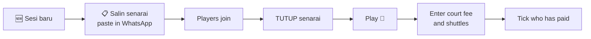

<div align="center">


# Tenang BC — Senarai Hadir Minton

**A badminton session sign-up app for our club. No login, no app to install — just one link.**

[](https://tinyurl.com/tenangbc)


[What it does](#-what-it-does) · [For players](#-for-players) · [For the admin](#-for-the-admin) · [Set it up](#-set-it-up) · [Settings](#%EF%B8%8F-settings) · [FAQ](#-faq)

</div>

---

## 🏸 What it does

It replaces the WhatsApp "copy the list, add your name, paste it back" routine.

| Before | Now |
|---|---|
| Copy-paste a name list in the group | Tap **Hadir ✅** on one permanent link |
| Names get lost when two people paste at once | Everyone is numbered in the order they joined |
| Someone counts courts by hand | Courts are worked out automatically |
| Someone works out who owes what | Fee per person is calculated and rounded up to RM1 |
| No record of late dropouts | Every withdrawal is logged, with a "Selepas TUTUP" flag |

The data lives in a Google Sheet that the admin owns, so nothing is locked inside the app.

## 🙋 For players

1. Open **[tinyurl.com/tenangbc](https://tinyurl.com/tenangbc)**.
2. Type your name. A phone number is optional and only the admin sees it.
3. Tap **Hadir ✅**.

Your phone remembers you, so next week it is one tap.

<details>
<summary><b>Bringing a friend</b></summary>

<br>

After you have joined, tap **➕ Bawa tetamu (+1)**. You can add up to 3 guests. They appear as `Ali (tetamu Adib)` and count toward the court count and the fee.

</details>

<details>
<summary><b>Can't make it</b></summary>

<br>

Tap **Tarik diri** next to your name. Your guests are withdrawn with you. You can only withdraw your own entries.

You can still withdraw after the list is closed, but it is recorded as **Selepas TUTUP**, so please tell the admin as well.

</details>

<details>
<summary><b>What if the list is full?</b></summary>

<br>

The main list holds 18 players. From number 19 onward you go into **Senarai menunggu** and move up automatically when someone withdraws.

</details>

<details>
<summary><b>My name is in the list but there is no "Tarik diri" button</b></summary>

<br>

Your browser has forgotten you (new phone, different browser, private tab). Type the **same name and phone number** you registered with and tap **Hadir ✅** again. The app reconnects you to your existing entry.

If you registered without a phone number, ask the admin.

</details>

### Court rules

| Players | Courts |
|---|---|
| 7 or fewer | 1 court |
| 12 or fewer | 2 courts |
| 18 or fewer | 3 courts |

Subject to hall availability.

> [!IMPORTANT]
> **JIKA TIDAK DAPAT HADIR LAST MINUTE, MOHON MAKLUMKAN PADA ADMIN.**

## 🛠 For the admin

Scroll to the bottom of the page, tap **🔒 Admin** and enter the PIN. There is no account; the PIN is checked on the server every time.

### Weekly routine



<details>
<summary><b>Everything the admin can do</b></summary>

<br>

| Action | Where |
|---|---|
| Open or close the list | **TUTUP senarai** / **Buka semula senarai** |
| Copy the list in the club's WhatsApp format | **📋 Salin senarai** |
| Change date, time, venue, map link | **✏️ Edit sesi** |
| Start next week's session | **🆕 Sesi baru** (pre-filled from the last one) |
| Add someone by hand | **➕ Tambah pemain** |
| Fix a name or phone number | ✏️ next to the player |
| Remove a player | 🗑️ next to the player |
| Mark a player as paid | **bayar** tick box |
| Message a player | Tap their phone number (opens WhatsApp) |
| Change the PIN | **🔑 Tukar PIN** |

</details>

<details>
<summary><b>How the fee is calculated</b></summary>

<br>

The admin enters three numbers: court fee, shuttles used, price per shuttle.

```
per person = (court fee + shuttles × price per shuttle) ÷ players in the main list
```

The result is **rounded up to the nearest RM1**. Guests count as players; the waiting list does not.

Example: court RM90.50 + 3 shuttles × RM12 = RM126.50 ÷ 18 players = RM7.03 → **RM8 / org**.

Players only see the final amount. The admin sees the breakdown while typing.

</details>

<details>
<summary><b>What the copied list looks like</b></summary>

<br>

```
*Minton*
Hari: *Ahad*
Tarikh: *15/11/2026*
Masa: *9 pagi - 11 pagi*
Tempat: *K Six Badminton Arena*
https://maps.app.goo.gl/...
Court: 2 Court

1. dc ✅
2. adib
3. Ali (tetamu adib)

Bayaran: *RM10/org*
- <=7 org = 1 court
- <=12 org = 2 court
- <=18 org = 3 court
- berpandukan kekosongan dewan
- *JIKA TIDAK DAPAT HADIR LAST MINUTE, MOHON MAKLUMKAN PADA ADMIN*
Daftar / tarik diri di sini: https://tinyurl.com/tenangbc
```

A waiting list, the `======TUTUP======` line and the fee line appear only when they apply.

</details>

## 🚀 Set it up

You need a Google account and about 10 minutes. No programming.

1. Create a Google Sheet, then **Extensions → Apps Script**.
2. Paste [`Code.gs`](Code.gs) and add an HTML file named `Index` with the contents of [`Index.html`](Index.html).
3. Run the **`setup`** function once and allow the permissions.
4. **Deploy → New deployment → Web app** — Execute as **Me**, access **Anyone**.
5. Open the link, sign in as admin with PIN `1234` and **change the PIN straight away**.

📖 The full walkthrough with every click is in **[SETUP-GUIDE.md](SETUP-GUIDE.md)**.

> [!WARNING]
> When you update the code later, use **Deploy → Manage deployments → ✏️ → New version**. Choosing "New deployment" creates a different link and breaks the one you shared.

## ⚙️ Settings

Everything adjustable is in the `CONFIG` block at the top of [`Code.gs`](Code.gs).

| Setting | Default | Meaning |
|---|---|---|
| `MAX_PLAYERS` | `18` | Main list size; beyond this is the waiting list |
| `MAX_GUESTS` | `3` | Guests each player may bring |
| `INITIAL_PIN` | `1234` | Admin PIN created by `setup()` |
| `DEFAULT_WEEKDAY` | `0` | Day pre-filled for new sessions (0 = Ahad … 6 = Sabtu) |
| `DEFAULT_TIME` | `9 pagi - 11 pagi` | Time for the first session |
| `DEFAULT_VENUE` | `K Six Badminton Arena` | Venue for the first session |
| `DEFAULT_MAP` | Google Maps link | Map link for the first session |
| `DEFAULT_SHUTTLE_PRICE` | `12` | RM per shuttle |
| `TIMEZONE` | `Asia/Kuala_Lumpur` | Used for dates and timestamps |
| `COURT_TIERS` | `7→1, 12→2, 18→3` | Players-to-courts rule |
| `APP_URL` | short link | Link printed at the bottom of the copied list |

Later sessions reuse the previous session's time, venue, map and shuttle price.

## 🔒 Privacy and security

- **Phone numbers are private.** They are never sent to other players' browsers; only the admin view, after the PIN is checked on the server, includes them.
- **Admin is locked for 10 minutes** after 10 wrong PINs.
- **Players are identified by their browser**, not an account. A player can only withdraw their own entries, checked on the server.
- **Every Sheet cell is stored as plain text**, which keeps the leading 0 in phone numbers and stops anyone typing a formula as their name.

> [!NOTE]
> A player who has lost their browser identity can reconnect with the same name and phone number. Members of a WhatsApp group can see each other's numbers, so this relies on trust between members. Withdrawals are always logged.

## 🗂 What's in this repo

| File | Purpose |
|---|---|
| [`Code.gs`](Code.gs) | Server: rules, validation, Sheet reads and writes |
| [`Index.html`](Index.html) | The whole page: HTML, CSS and JavaScript in one file, no libraries |
| [`SETUP-GUIDE.md`](SETUP-GUIDE.md) | Step-by-step setup and troubleshooting |
| [`assets/logo.jpg`](assets/logo.jpg) | Club logo used in this README |

The Google Sheet has three tabs: `Sesi` (sessions, including the archive), `Pemain` (sign-ups) and `TarikDiri` (the dropout log).

## ❓ FAQ

<details>
<summary><b>I forgot the admin PIN</b></summary>

<br>

In Apps Script: ⚙ **Project Settings → Script Properties** → edit `ADMIN_PIN` → save.

</details>

<details>
<summary><b>It says "Terlalu banyak PIN salah"</b></summary>

<br>

Admin access locks for 10 minutes after 10 wrong PINs. Wait and try again.

</details>

<details>
<summary><b>It says my name is already in the list</b></summary>

<br>

Two players can't share a name in one session. Add a letter, for example `Adib K`. If the existing entry is yours, enter the same phone number you registered with and the app will reconnect you.

</details>

<details>
<summary><b>Where do old sessions go?</b></summary>

<br>

Nowhere. Starting a new session leaves the old rows in the Sheet as an archive; the app simply shows the latest session.

</details>

<details>
<summary><b>Can I remove the grey Google banner at the top?</b></summary>

<br>

No. Google adds "This application was created by a Google Apps Script user" to every web app on a free account.

</details>

---

<div align="center">

**Tenang BC** · est. 2022 · Jumpa di court 🏸

</div>
